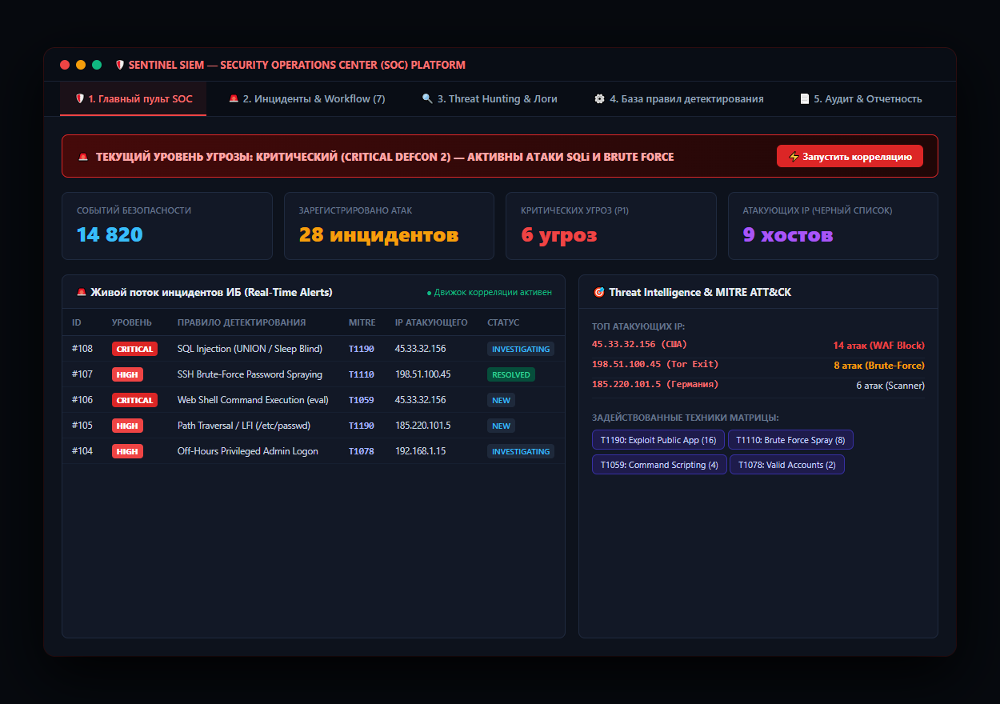

# Sentinel SIEM

Система мониторинга событий информационной безопасности (SOC / SIEM) и автоматизированного расследования инцидентов. 

Платформа выполняет нормализацию разнородных журналов (Linux `auth.log`, Nginx Access Logs, Windows Security EventID), корреляцию событий во временных окнах, сопоставление техник атак с матрицей **MITRE ATT&CK** и управление жизненным циклом инцидентов.



## Архитектура системы

```text
sentinel-siem/
├── sentinel/
│   ├── parsers/               # Парсеры форматов журналов
│   │   ├── base_parser.py     # Базовая структура ParsedEvent
│   │   ├── web_parser.py      # Nginx / Apache Combined Log Format
│   │   ├── syslog_parser.py   # Linux Syslog & SSH authentication
│   │   └── windows_parser.py  # Windows Security Events (4624, 4625, 4720, 4672)
│   ├── engine/                # Движки аналитики угроз
│   │   ├── signature_rules.py # Сигнатурный детектор (SQLi, LFI, XSS, Web Shell)
│   │   ├── correlation_engine.py # Корреляция Brute-Force, сканеров, аномалий
│   │   └── report_generator.py # Генератор аудиторских сводок ИБ
│   ├── database/              # Слой базы данных SQLite
│   │   └── db_manager.py      # Хранение событий, инцидентов и метрик SOC
│   ├── sample_data/           # Генератор боевых сценариев атак для тестирования
│   │   └── generator.py
│   └── ui/
│       └── app.py             # 5-вкладочный интерфейс дежурного инженера SOC
├── tests/                     # Unit-тесты детектирования атак
└── run_siem.py                # Точка входа для запуска GUI
```

## Функционал и вкладки

1. **🛡️ Главный пульт SOC (SOC Overview):**
   - Индикатор уровня угрозы (DEFCON Threat Level).
   - KPI-карточки: общий объем событий, количество инцидентов, критические угрозы (P1) и уникальные атакующие IP.
   - Рейтинг наиболее агрессивных источников атак с фиксацией IP.
   - Распределение атак по матрице MITRE ATT&CK (Credential Access, Initial Access, Discovery).

2. **🚨 Инциденты & Workflow:**
   - Журнал инцидентов с градацией по критичности (CRITICAL, HIGH, MEDIUM, LOW).
   - Управление статусом: перевод в статус «В работе» (`INVESTIGATING`) и «Устранено» (`RESOLVED`).
   - Инспектор полезной нагрузки (Payload): выявление внедренных SQL-команд, шеллов или путей к файлам.

3. **🔍 Threat Hunting & Поиск логов:**
   - Полнотекстовый поиск по сырым событиям с фильтрацией по IP-адресу и ключевым словам.

4. **⚙️ База правил детектирования:**
   - Управление активными сигнатурными и корреляционными правилами.
   - Настройка порогов срабатывания (порог попыток брутфорса, окна сканирования портов, нерабочие часы).

5. **📄 Аудит & Отчетность:**
   - Генерация формализованного HTML-отчета об инцидентах для руководства и аудиторов безопасности.

## Запуск

1. Клонируйте репозиторий:
   ```bash
   git clone https://github.com/username/sentinel-siem.git
   cd sentinel-siem
   ```
2. Установите зависимости:
   ```bash
   pip install -r requirements.txt
   ```
3. Запустите платформу:
   ```bash
   python run_siem.py
   ```
4. Запуск юнит-тестов:
   ```bash
   pytest tests/
   ```

